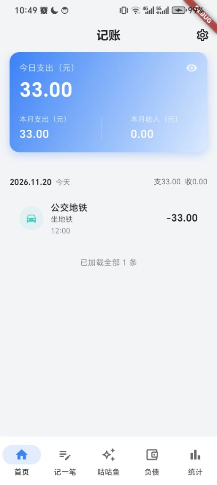
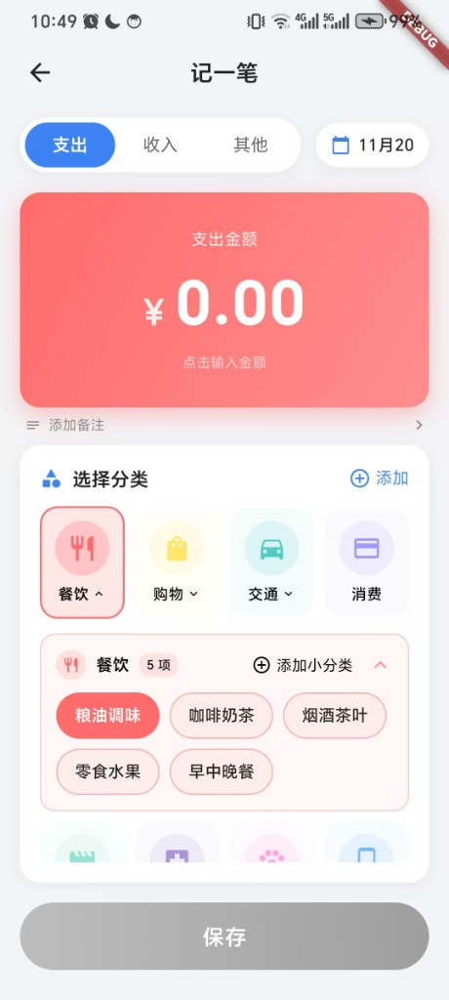
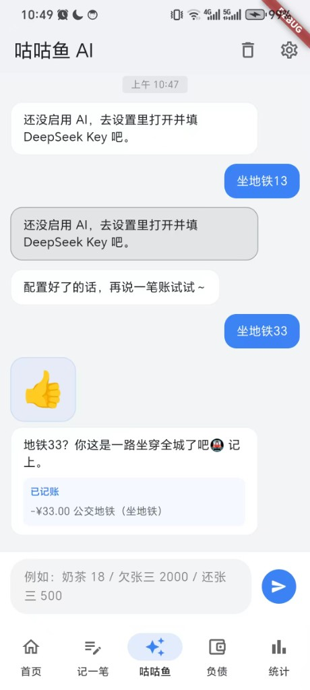
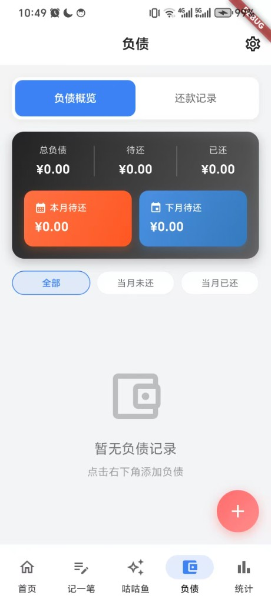
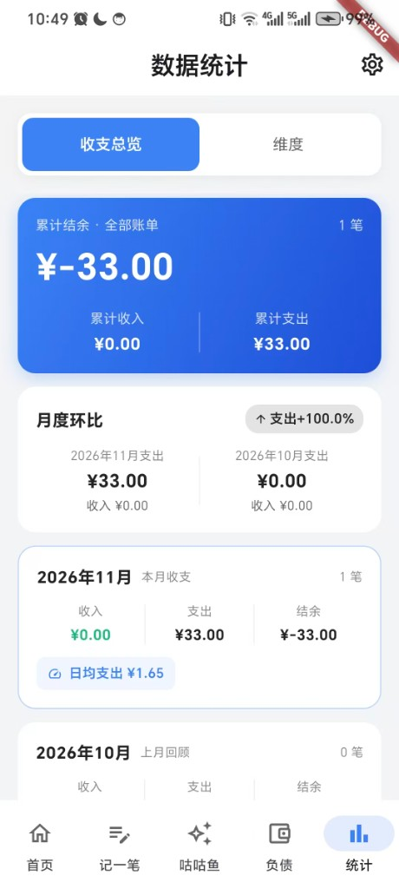
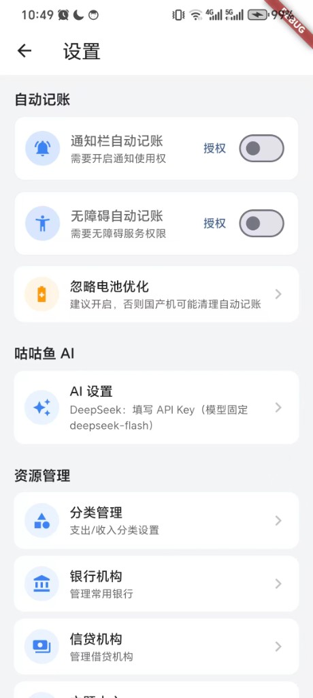

# 咕咕鱼记账 (gugu_bill)

> AI 智能全自动记账 App —— 基于 Flutter / Dart，**数据存本地 Drift**。  
> 支持 **DeepSeek 对话记账 / 记负债 / 还债**，以及 Android **无障碍 + 通知栏**自动识别入账（含拼多多等场景）。

当前版本：`1.1.4+6`  
仓库：`gitee.com:guguyuo/gugu-fish-accounting.git`

---

## 目录

- [界面预览](#界面预览)
- [核心特性](#核心特性)
- [技术栈](#技术栈)
- [功能模块](#功能模块)
- [咕咕鱼 AI](#咕咕鱼-ai)
- [项目结构](#项目结构)
- [快速开始](#快速开始)
- [构建 & 运行](#构建--运行)
- [代码生成](#代码生成)
- [包名说明（正式版红线）](#包名说明正式版红线)
- [主题与颜色规范](#主题与颜色规范)
- [数据存储规范](#数据存储规范)
- [SourceHash 防重复](#sourcehash-防重复)
- [Android 原生集成](#android-原生集成)
- [业务约束](#业务约束)
- [常见问题](#常见问题)

---

## 界面预览

| 首页 | 记一笔 | 咕咕鱼 AI |
|:---:|:---:|:---:|
|  |  |  |

| 负债 | 统计 | 设置 |
|:---:|:---:|:---:|
|  |  |  |

---

## 核心特性

- **咕咕鱼 AI（DeepSeek）**：自然语言对话完成记账、记负债、还债；性格可选；本地聊天历史 + 下拉分页 + 打字机输出 + 微信风格时间条。
- **无障碍自动记账**：Android `AccessibilityService` 监听支付/电商页面（如拼多多支付成功），解析金额与标题规格并入账。
- **通知栏自动记账**：`NotificationListenerService` 监听支付通知（可与无障碍配合）。
- **防重复 SourceHash**：来源文本 SHA-256 去重，避免同笔重复入账。
- **本地数据库**：Drift / SQLite；账单/负债/聊天等直接落本地，**无 Mock 模式、无离线同步队列**。
- **主题中心**：多套主题 + 自定义主题，颜色跟随主题切换。
- **五栏导航**：首页 / 记一笔 / 咕咕鱼 / 负债 / 统计。

---

## 技术栈

| 领域 | 选型 |
|---|---|
| 框架 | Flutter 3.10+ / Dart 3.9+ |
| 状态管理 | Provider 6.x |
| 本地数据库 | Drift 2.22 + sqlite3_flutter_libs |
| 网络 | Dio（预留；业务以本地库为准） |
| AI | DeepSeek OpenAI 兼容接口（`deepseek-flash`） |
| 路由 | fluro |
| 图表 | fl_chart |
| 权限 | permission_handler |
| 金额 | decimal（禁止 double 直接算钱） |
| 工具 | intl / uuid / crypto / share_plus / file_picker / flutter_colorpicker |

> 依赖大版本以 `.cursorrules` / `pubspec.yaml` 为准，禁止随意升级。

---

## 功能模块

### 五栏主框架（`lib/main.dart` → `MainNavigation`）

| 顺序 | 名称 | 页面 | 说明 |
|---|---|---|---|
| 0 | 首页 | `home_page.dart` | 本月收支、账单流、自动记账状态、多选等 |
| 1 | 记一笔 | `record_page.dart`（独立 push） | 手动记账；点 Tab 不切 IndexedStack 空白页 |
| 2 | 咕咕鱼 | `gugu_ai_page.dart` | DeepSeek 对话记账 / 记负债 / 还债 |
| 3 | 负债 | `debt_page.dart` | 负债概览、列表、新增、还款流水 |
| 4 | 统计 | `statistics_page.dart` | 日/周/月/年筛选、图表、排行 |

### 辅助页面

- `ai_settings_page.dart`：启用 AI、性格、DeepSeek API Key（保存后关闭页面）
- `add_liability_page.dart`：新增/编辑负债（信用卡/房贷/车贷/分期/私人借款/月付信贷）
- `setting_page.dart`：自动记账开关、权限、备份导入导出、入口到 AI 设置
- `theme_center_page.dart`：主题中心
- `resource_management_page.dart`：银行 / 信贷机构 / 分类等资源

---

## 咕咕鱼 AI

### 能力

用户自然语言经 DeepSeek `/chat/completions` 返回 JSON，本地只负责落库：

| 意图 | JSON 字段 | 落库 |
|---|---|---|
| 普通消费/收入 | `bills` | `BillProvider.addBill` |
| 新欠债/借款/信用卡账单等 | `liabilities` | `LiabilityProvider.addLiability` |
| 还债/还清 | `repays` | `LiabilityProvider.addRepay`（匹配未结清负债） |

示例：

- `午饭 28` → 记账
- `欠张三 2000` → 记负债
- `还张三 500` / `信用卡还清` → 还债

### 体验

- 性格预设：毒舌 / 温柔 / 正经 / 可爱 / 省钱教练（`deepseek_config.dart`）
- 价值判断按「物品 + 价格常识」，不用死板金额档
- 聊天历史本地持久化；下拉加载更早 50 条
- 助手回复打字机逐字输出
- 微信风格时间分隔（间隔 > 5 分钟显示）

### 配置

设置 → 咕咕鱼 AI / 聊天页右上角齿轮：

1. 打开「启用 AI」
2. 填写 DeepSeek API Key（仅存本机）
3. 选择性格并保存

固定模型：`deepseek-flash`  
Base URL：`https://api.deepseek.com`

---

## 项目结构

```
lib/
├── main.dart
├── ui_constants.dart
├── android_channel/
│   ├── accessibility_channel.dart
│   ├── auto_record_service.dart
│   ├── keep_alive_channel.dart
│   └── notification_channel.dart
├── database/
│   ├── database.dart          # 表定义 / 迁移 / DAO（当前 schemaVersion = 12）
│   └── database.g.dart        # build_runner 生成，勿手改
├── pages/
│   ├── gugu_ai_page.dart
│   ├── ai_settings_page.dart
│   ├── home_page.dart / record_page.dart / debt_page.dart / statistics_page.dart
│   └── ...
├── providers/
├── services/
│   ├── deepseek_config.dart   # 模型默认值、性格/贴纸预设
│   ├── gugu_ai_service.dart   # DeepSeek 对话 + 记账/负债/还债
│   └── network_service.dart
├── theme/
├── utils/money.dart
└── widgets/

android/app/src/main/kotlin/com/example/demo_app/
├── BillAccessibilityService.kt
├── BillNotificationListenerService.kt
├── AutoRecordKeepAliveService.kt
└── parser/
    ├── PaymentAppParser.kt
    ├── PaymentParseResult.kt
    └── PinduoduoPaymentParser.kt   # 拼多多支付页解析
```

### 主要数据表

| 表 | 用途 |
|---|---|
| `local_user_config` | 用户配置（含 AI 开关 / Key / 性格等） |
| `local_ai_chat_messages` | 咕咕鱼聊天历史 |
| `local_accounts` / `local_bills` | 账户 / 账单 |
| `local_liabilities` / `local_liability_repays` | 负债 / 还款 |
| `local_categories` / `local_banks` / `local_credit_institutions` | 分类 / 银行 / 信贷机构 |

> schemaVersion ≥ 12 起已删除 `offline_sync_queue`。

---

## 快速开始

### 环境

- Flutter 3.10+ / Dart 3.9+
- Android：JDK 17+、SDK 34（无障碍/通知栏能力）
- iOS / 桌面：可编译调试，无系统级自动记账监听

```bash
flutter pub get
dart run build_runner build --delete-conflicting-outputs
```

---

## 构建 & 运行

```bash
# 调试（默认安装 debug 包：com.guguyu.gugu_bill.debug）
flutter run

# Release APK / AAB
flutter build apk --release
flutter build appbundle --release
```

Release 签名读取 `android/key.properties`（已 gitignore，勿提交）。示例见 `android/key.properties.example`。

---

## 代码生成

修改 `lib/database/database.dart` 后必须重新生成：

```bash
dart run build_runner build --delete-conflicting-outputs
```

---

## 包名说明（正式版红线）

| 包名 | 用途 |
|---|---|
| `com.guguyu.gugu_bill` | **正式版**，含用户真实数据 |
| `com.guguyu.gugu_bill.debug` | 调试包（`applicationIdSuffix = ".debug"`） |

正式版禁止擅自 `install` / `uninstall` / `pm clear` / `force-stop` / 覆盖安装。调试请只用 `.debug` 包，且需明确授权后再装跑。详见 `.cursorrules` 与 `.cursor/rules/no-release-device-ops.mdc`。

---

## 主题与颜色规范

所有 UI 颜色从主题动态读取，禁止硬编码 `Color(0xFF...)`。  
`const` 不能用于 `AppColors.xxx` 读取处。详情见 `.cursorrules`。

---

## 数据存储规范

可枚举业务数据（银行、分类、信贷机构等）必须进 Drift 表，禁止在源码堆字典常量。  
金额统一 `Decimal` + `utils/money.dart`。

---

## SourceHash 防重复

短信 / 通知 / 无障碍 / 负债还款等来源写入 `local_bills.sourceHash`，入库前去重。

---

## Android 原生集成

- **无障碍**：`BillAccessibilityService` + `parser/*`（拼多多等）→ EventChannel / MethodChannel → Dart `AutoRecordService`
- **通知栏**：`BillNotificationListenerService`
- **保活**：`AutoRecordKeepAliveService`

系统设置中需手动开启「咕咕鱼」无障碍 / 通知使用权。

---

## 业务约束

1. 统计以本地聚合为准，金额用 `Decimal`。
2. 不再使用离线同步队列 / Mock 模式。
3. `sourceHash` 防重复。
4. 转账不计入收支统计。
5. AI 对话记账/记负债/还债：以模型返回 JSON 为准。
6. Android 可监听；iOS 仅提示系统限制。
7. 禁止提交 `android/key.properties`、密钥、用户数据库文件。

---

## 常见问题

**Q: 改了 `database.dart` 没生效？**  
A: 重新执行 `build_runner` 生成 `database.g.dart`，并完整重启 App 以跑迁移（含 v12 删除同步队列表）。

**Q: 咕咕鱼不记账？**  
A: 检查 AI 是否启用、API Key 是否填写；看日志里 `AI 解析结果 bills/liabilities/repays` 条数。

**Q: 无障碍听不到拼多多？**  
A: 确认系统已授权 **debug/正式对应包名** 的无障碍服务，并重新打开目标 App；必要时杀进程后重进。

**Q: 退出重进底部没有「咕咕鱼」？**  
A: 底部五栏在 `main.dart`，需完整 `flutter run` 安装，不能只靠热重载。

**Q: iOS 能自动记账吗？**  
A: 不能监听系统支付页/通知到同等深度，设计上仅 Android 主推自动记账。

---

## 许可与说明

本仓库为咕咕鱼记账工程源码。DeepSeek Key、签名文件等敏感信息请自行本地配置，勿提交到 Git。
